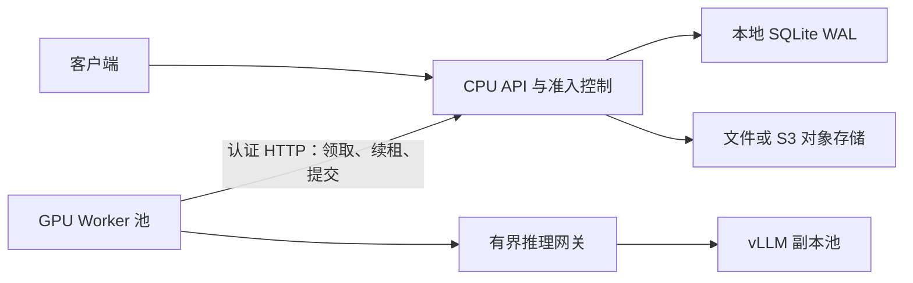

# SQLite 调度架构

## 调度与恢复

SQLite 使用短的 BEGIN IMMEDIATE 事务串行化状态修改，WAL 允许其他连接读取。推理和文件传输不在数据库事务中执行。API 镜像固定使用 SQLite 3.51.3，并验证源码 SHA-256；队列拒绝使用未修复已知并发 WAL-reset 问题的运行库。

任务从 queued 进入 running 时生成随机租约。worker 定期续租，结果提交必须携带当前有效租约；过期 worker 的结果不能覆盖新尝试。相同租约重复提交成功结果是幂等操作。租约失效后进行有上限的退避重试，次数耗尽则失败。

worker 使用独立线程续租。若无法及时续租或超过执行硬期限，会终止整个 worker 进程，避免失去所有权的本地 GPU 调用继续运行。该进程上的其他在途任务也会在租约过期后恢复。正常停止会先停止领取新任务，等待当前任务完成；容器超过停止宽限后被终止时同样依靠租约恢复。

## 容量与公平性

全局预算包括上传/校验并发、同步等待数、运行及排队任务总数、加权工作量，以及文件传输并发。任务成本为页数乘以档位权重（flash/basic/standard/advanced 分别为 1/2/3/6），只是估算，不等价于实际 GPU 秒数。

8 页及以下视为短任务，批量任务保留一个短任务名额；等待超过 60 秒的任务提高领取优先级，避免长期饥饿。worker 只在执行线程空闲时领取任务。空闲轮询主要是读取，只定期刷新存活状态，减少 SQLite 写入争用。

任务队列有上限，超过预算返回 503 和 Retry-After，单文件超过工作量预算返回 413。增加等待队列不会增加处理能力。容量应根据实际文档分布、P95/P99 目标及已预热资源调整。

## 文件与缓存

SQLite 只保存元数据，对象键为随机标识。输入文件先持久化，再提交任务；未提交的上传由租约跟踪。每次执行尝试使用独立结果键，完成数据库提交后才发布结果。过期上传、失效尝试和到期结果通过持久化垃圾清单清理，删除失败可以重试。

local 后端使用原子替换与文件/目录同步；s3 后端可配置 S3_BUCKET、S3_ENDPOINT_URL 和标准 AWS 凭据。只有调度端访问对象存储，worker 通过认证 API 下载输入和上传结果。文件和大结果仍经过调度端，带宽和内存会成为进一步扩容时需要测量的资源；后续可增加预签名直传和下载。

全局内容缓存与幂等键分开管理。缓存键包含输入内容、档位、图片选项、MinerU 版本和 MODEL_REVISION。缓存淘汰只取消复用，不提前删除仍在保留期内的任务结果。升级模型或解析器前应排空任务，统一更新调度端、worker 与模型版本配置。

## 观测

API 的 mineru_stage_seconds 记录上传、校验、存储、任务等待、SDK、Markdown 渲染，以及 SDK 支持的 PDF 阶段。SDK 阶段是嵌套墙钟计时，可能重叠，不能把所有阶段简单相加。mineru_tasks、mineru_work_units、mineru_oldest_wait_seconds 和 mineru_workers 描述全局状态。

推理网关单独记录 HTTP 调用耗时和准入等待，按活跃请求数选副本；上游失败短暂避让。网关不读取或记录模型输入内容。进一步定位 vLLM 排队、prefill、decode 或 KV 缓存问题，需要同时采集各个 vLLM 服务的指标。

API 指标是同一个 SQLite 数据库的全局视图，多 API 进程不会产生独立计数。采集多个 API 副本时应选择单一全局采集入口，或对重复全局视图取 max，不能直接相加。网关指标属于网关进程，当前部署保持一个网关进程。

## 部署边界

SQLite 文件必须位于调度主机本地持久磁盘，不能通过 NFS 让不同主机直接打开 WAL 文件。worker 通过 HTTP 可以跨机器扩容，不受这个文件共享限制。

当前调度端仍有单节点故障边界，单个 SQLite 写入者、文件中转和推理网关都有有限容量；这不是跨节点主动主动的控制平面。备份使用 SQLite 在线 backup API，不复制正在变化的单个数据库文件。恢复需要同时保留关联对象存储；数据库备份本身不包含 PDF 和 Markdown。

先验证单 GPU 与双 GPU 的扩容效率、固定速率负载、worker 故障及 API 重启恢复。若元数据事务或控制平面可用性成为限制，再替换队列实现；GPU worker 的 HTTP 协议和存储接口可以保持。

参考：[SQLite WAL 与并发约束](https://sqlite.org/wal.html)、[Python SQLite 在线备份](https://docs.python.org/3/library/sqlite3.html#sqlite3.Connection.backup)、[vLLM 指标](https://docs.vllm.ai/en/latest/design/metrics/)。
