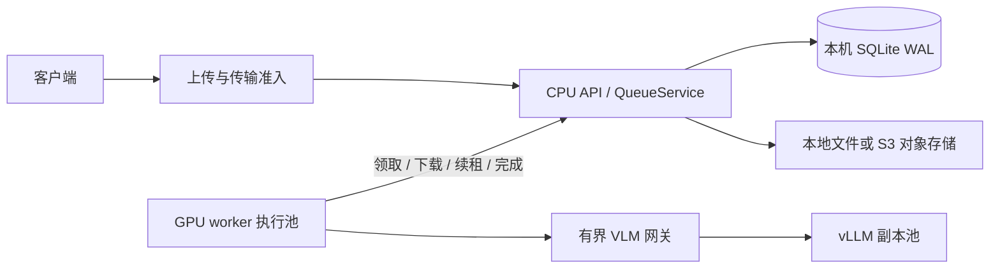
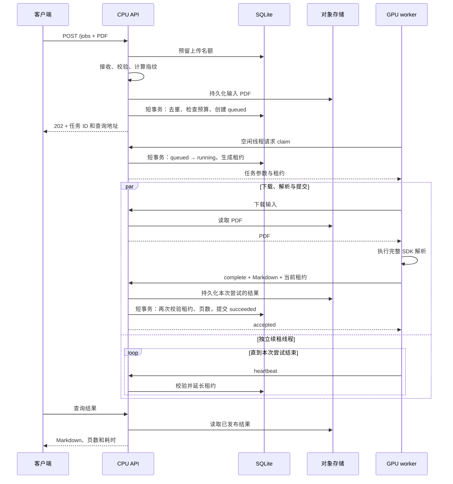
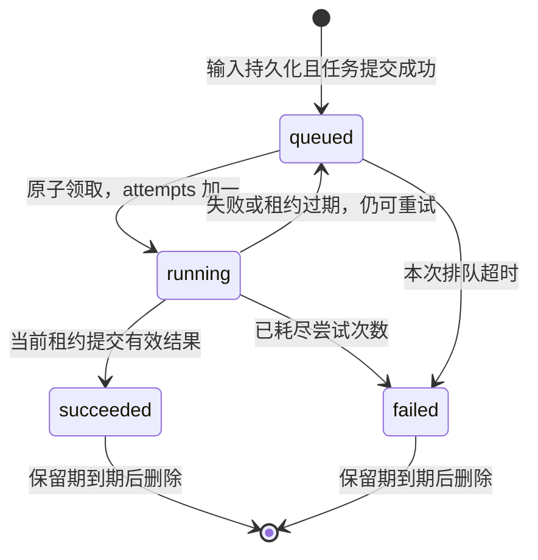

# 调度器实现与异常处理

本文对应服务 1.1.0 的 `SERVICE_MODE=queue` 实现，默认部署使用此模式。`inline` 是保留的进程内兼容实现，不具备本文描述的持久队列和跨进程全局调度能力。

调度器由 CPU API 内的协调逻辑和 SQLite WAL 组成。GPU worker 有空闲执行线程时，通过 HTTP 主动领取一份完整 PDF；协调端在短事务内确认任务归属，模型执行期间不持有数据库事务。系统不按页拆分任务，也没有自动扩缩容控制器。

## 1. 组件和数据归属



| 组件 | 职责 | 代码入口 |
| --- | --- | --- |
| HTTP 接口 | 校验 PDF，提交任务，同步等待或异步查询 | [main.py](../app/main.py)、[job_api.py](../app/job_api.py) |
| 准入中间件 | 在 multipart 解析前限制上传；限制同步等待和文件传输 | [admission.py](../app/admission.py) |
| 调度服务 | 计算指纹，持久化文件，衔接数据库，运行维护循环 | [queue_service.py](../app/queue_service.py) |
| 状态与调度规则 | 容量、去重、领取、租约、重试、过期和指标 | [jobs.py](../app/jobs.py) 中的 `QueueStore` |
| GPU worker | 预热、按空闲线程领取、独立续租、执行 SDK、提交结果 | [worker.py](../app/worker.py) |
| 推理网关 | 将 VLM 请求分配到副本，限制活跃与等待请求 | [vlm_gateway.py](../app/vlm_gateway.py) |
| 文件存储 | 保存 PDF 和 Markdown；数据库只保留对象键 | [storage.py](../app/storage.py) |

只有协调端打开 SQLite 和对象存储。worker 可以部署在其他机器，通过带认证的 HTTP 接口工作，不需要共享数据库文件或对象目录。任务调度决定“哪份 PDF 交给哪个空闲 worker”，VLM 网关决定“该 PDF 内的一次模型请求交给哪个 vLLM 副本”，两者是独立的调度层。

### SQLite 保存什么

| 表 | 主要内容 |
| --- | --- |
| `jobs` | 状态、输入指纹、对象键、页数、档位、成本、尝试次数、租约、时间和错误码 |
| `idempotency` | 幂等键摘要到任务的映射；多个键可以指向同一任务 |
| `uploads` / `waiters` / `transfers` | 全局上传、同步等待及文件传输名额和到期时间 |
| `workers` | worker 最近活动时间，用于存活统计 |
| `garbage` | 待删除对象键；删除失败后保留以便重试 |
| `limits` | 持久化的任务数量、加权工作量和上传并发上限 |
| `metrics` / `counters` | 固定标签的阶段直方图和任务事件计数 |
| `schema_version` | 数据库结构版本，启动时检查兼容性 |

每次数据库操作单独建立连接；写操作使用 `BEGIN IMMEDIATE`，配置 `busy_timeout=5000` 和 `synchronous=FULL`。WAL 允许读取与写入并行，但同一时刻仍只有一个写入者。文件读写、PDF 校验和模型调用都在数据库事务之外。

## 2. 一份 PDF 的完整流程



这张图表示新建任务。命中幂等记录、在途去重或结果缓存时，会返回已有任务，不重复占用任务预算；本次上传产生的多余输入进入清理流程。当前实现仍会先接收和存储输入，再在数据库事务中判断是否复用。

`POST /v2/parse/file` 走同一持久队列，但在提交后轮询等待结果，而不是立即返回任务 ID。上传与校验完成后释放上传名额，同步等待名额保持到响应结束。`Idempotency-Key` 当前只由 `POST /jobs` 读取。

### 指纹、去重与幂等

输入指纹为 PDF 内容及以下参数的 SHA-256 摘要：解析档位、图片选项、MinerU 版本和 `MODEL_REVISION`。

- 默认情况下，相同指纹的 `queued` / `running` 任务合并，相同指纹的可用成功结果直接复用。
- `disable_cache=true` 同时跳过内容缓存和内容去重，重复内容可以创建不同任务。
- 显式幂等键仍然有效：同一键、同一指纹返回原任务；同一键、不同指纹返回 409。键本身以摘要保存。
- 幂等记录也会返回原来的失败任务，不会自动重新执行；任务到保留期限被删除后，对应幂等记录一并删除。
- 缓存按完成时间优先保留较新的、能放入字节预算的结果，不是按读取时间更新的 LRU。超出预算或 TTL 到期只取消复用资格，原任务结果仍保留到任务保留期结束。

## 3. 容量与领取顺序

容量在 SQLite 中统一检查，适用于共享同一本地数据库的多个 API 进程，而不是每个进程各算一份。

| 限制 | 统计对象 | 默认部署值 | 超限行为 |
| --- | --- | ---: | --- |
| `QUEUE_MAX_UPLOADS` | 上传、校验和输入持久化中的请求 | 8 | 503，`Retry-After: 5` |
| `QUEUE_MAX_SYNC_WAITERS` | 同步接口在途请求 | 8 | 503，`Retry-After: 5` |
| `MAX_PENDING` | `queued + running` 任务 | 64 | 503，`Retry-After: 5` |
| `QUEUE_MAX_WORK` | 所有在途任务的加权页数 | 4096 | 总量满返回 503；单文件本身超限返回 413 |
| `QUEUE_MAX_TRANSFERS` | 异步结果下载、worker 输入下载与结果上传 | 8 | 503，`Retry-After: 1` |

这些值来自默认 Compose 配置；直接运行 Python 时，`Settings.max_pending` 默认是 8。`MAX_PENDING`、`QUEUE_MAX_WORK` 和 `QUEUE_MAX_UPLOADS` 的初值写入 `limits` 表，其他限制由各 API 进程的配置提供，应保持一致。

任务成本为 `页数 × 档位权重`，flash/basic/standard/advanced 权重分别为 1/2/3/6。它是准入估算，不是实际 GPU 时间。所有在途任务都参与数量和工作量预算；复用已有任务不会额外增加任务数。

每个 worker 启动 `PARSE_WORKERS` 个执行线程，默认 2。线程空闲时才领取任务，不提前缓存一批待执行 PDF。领取时只考虑 `state=queued AND available<=当前时间` 的任务，按以下顺序选一条：

1. 本次排队已超过 60 秒的任务。
2. 其余 8 页及以下的短任务。
3. 其余长任务。

同一组内按 `queued` 时间、任务 ID 排序。在一个写事务内完成选择、更新为 `running`、增加 `attempts` 并生成随机 `lease_token`，因此并发领取不会把同一次有效尝试交给多个线程。没有可领取任务时返回 204，worker 默认每 0.25 秒再尝试；空闲存活更新时间受到节流。

当 `MAX_PENDING>1` 时，长任务最多占用总任务上限减一的名额，为短任务保留一个**准入名额**。这里没有预留 GPU 执行线程，不会抢占正在执行的长任务；页数大、计算复杂度不同的任务也没有严格时间公平保证。

## 4. 状态机、租约与重试



租约定义当前尝试的所有权，不是数据库长事务。默认领取后有效 60 秒，worker 每 10 秒通过独立线程续租；服务器将到期时间延长为“当前时间 + 租约秒数”。输入下载、心跳和结果提交均要求有效租约，内部接口还要求 `WORKER_API_TOKEN` 认证。

完成接口先检查租约，再写结果对象，最后在数据库事务内再次检查租约和页数。每次尝试的结果键由本次随机租约生成，因此旧尝试与新尝试不共用结果键。只有数据库成功记录的 `output_key` 才对客户端发布。

成功后保留 `completed_token`：同一租约重发完成请求可获得成功确认，不重复计数。worker 对完成请求的传输异常最多尝试提交 3 次；HTTP 4xx/5xx 不走这段即时重发，而进入尝试失败处理。

调度提供的是**允许重复执行、校验租约后发布结果**的语义。worker 失联时无法证明其 GPU 调用已结束，新尝试可能与旧尝试短暂重叠；不保证整个模型调用恰好执行一次。

### 重试规则

解析异常、下载/提交失败会使 worker 尝试调用 `fail`；调用失败则等待租约过期，由协调端恢复。页数不匹配由协调端直接触发重试。重试时清除旧租约，重设 `queued`，并设置：

```text
available = 当前时间 + min(2 ** attempts, 30) 秒
```

默认最多执行 3 次，包含第一次，不是额外重试 3 次。第一次和第二次失败后分别等待 2 秒、4 秒；第三次失败进入 `failed`。当前没有随机抖动、按错误类型分类的重试或独立死信队列；确定性错误也可能用尽同样的尝试次数。

### 各种超时分别约束什么

| 配置 | 默认秒数 | 实际范围 |
| --- | ---: | --- |
| `QUEUE_UPLOAD_SECONDS` | 120 | 请求体接收期限；不等于 PDF 校验和存储的总期限 |
| `QUEUE_TRANSFER_SECONDS` | 120 | 受传输中间件保护的输入下载、结果上传和异步结果响应 |
| `REQUEST_TIMEOUT` | 6000 | 同步接口提交后等待结果的期限；不取消持久任务 |
| `QUEUE_MAX_QUEUE_SECONDS` | 300 | 本次 `queued` 时间，包含退避；每次重试重新计时 |
| `QUEUE_LEASE_SECONDS` | 60 | 本次执行所有权有效期，通过心跳延长 |
| `WORKER_MAX_RUN_SECONDS` | 6000 | 从领取后开始的执行尝试期限，覆盖下载、解析和提交，由心跳线程检查 |
| `QUEUE_RETENTION_SECONDS` | 86400 | 任务结束后，任务记录及结果的保留时间 |

worker 的下载和完成 HTTP 请求另设 60 秒客户端超时，可能早于传输中间件超时。执行期限和租约失联检测是在心跳循环中检查的，不是精确到设定秒数的强制定时器；心跳 HTTP 耗时和线程调度也会影响检测时间。

worker 收到心跳 409 时立即判定租约失效。其他续租错误可暂时容忍，但超过最近一次成功续租所推算的租约时长的 80% 后，会以退出码 70 终止整个进程。执行超时也采用同样方式，避免只取消 Python 等待而让本地原生 GPU 调用继续运行。该进程其他在途任务也要靠租约恢复；重启 worker 不等于强制取消独立 vLLM 服务已经接收的请求。

## 5. 异常情况如何处理

| 场景 | 当前实现的处理 | 客户端或运维应做什么 |
| --- | --- | --- |
| 非法、损坏、需要密码的 PDF，非法档位 | 入队前拒绝；通常为 400，参数校验为 422 | 修正输入，不原样无限重试 |
| 文件、页数、单文件工作量超限 | 413，不创建新任务 | 减小输入或调整经过评估的上限 |
| 上传、同步等待、传输或任务容量满 | 503，并附对应 `Retry-After` | 退避重试；持续超载时降低到达速率或扩容执行资源 |
| 接收请求体超时 | 上传守卫抛出 408，释放名额；此阶段尚无已提交任务 | 检查上传链路，重新上传 |
| 文件传输超过期限 | 响应尚未开始时返回 504；已开始则中断连接，不再改写状态码 | 查询任务状态后重试读取；worker 的下载或提交失败进入尝试失败处理 |
| 客户端断开或同步等待超时 | 已提交任务独立保留；服务端同步等待超时返回 504 | 高负载使用 `/jobs` 保存任务 ID；旧同步响应不提供任务 ID |
| 异步提交响应丢失 | 数据库可能已提交，客户端不能仅凭断线判断是否入队 | 用相同幂等键和输入重发 `/jobs`，获取原任务 |
| 领取响应丢失 | 任务可能已是 running，但 worker 没拿到租约，不能续租；过期后恢复，已领取次数仍计入 attempts | 无需手工改状态；关注频繁断线导致的重试消耗 |
| worker 被杀、容器崩溃或进程 OOM | 无法续租；租约过期后重新排队，耗尽次数后失败 | 恢复可用 worker，排查资源；持久数据仍由协调端保留 |
| SDK 抛错、下载或结果上传失败 | 尝试 `fail`；不能报告时等待租约到期 | 查看日志和失败码；修复持续故障，避免只增加重试次数 |
| 解析输出页数不符 | 完成接口返回 409，记录 `page_mismatch`，按策略重试 | 排查 SDK 和输入一致性 |
| 空 Markdown、无效 UTF-8、非法计时或过大结果 | 完成接口拒绝；正常 worker 随后报告失败，最终可能耗尽重试 | 修正输出或容量配置，不会自动降档或去图 |
| 完成响应在网络中丢失 | worker 重发完成请求；已成功的相同租约幂等确认 | 不必重建任务；查询原任务状态 |
| 旧 worker 延迟提交或续租 | 无效租约返回 409，不能替换新尝试结果；旧结果对象进入清理路径 | 无需人工选择旧结果；排查失联原因 |
| API 进程重启 | 已提交的 queued/running/终态记录保留；恢复后继续领取和清理 | 保留持久卷。长时间不可用可能导致 worker 退出、任务重试 |
| 排队超过期限 | 进入 `failed`，错误为 `queue_timeout`，释放任务预算 | 降低负载、增加容量；该任务不会无限等待 |
| 认证或版本不一致 | worker 接口返回 401，或领取返回 409；不领取新任务 | 统一凭据、MinerU 版本和 `MODEL_REVISION` |
| SQLite 运行库、数据库结构或初始容量配置不兼容 | 协调端启动失败，不自动迁移结构或覆盖原有限额 | 使用受支持镜像与结构版本；已有容量用管理命令调整后同步配置 |
| 数据库忙、不可写或磁盘满 | 单次数据库操作最多等待约 5 秒锁；事务失败回滚。上传预留失败映射 503，其他路径可能为 500 | 修复磁盘或争用。未实现全路径统一 503 或无限数据库重试 |
| 对象存储写入失败 | 不提交依赖该新对象的成功状态；worker 失败或等待租约恢复。S3 客户端另有有限请求重试 | 恢复存储；客户端遇到不明确的入队响应用幂等键重试 |
| 已成功结果文件丢失或损坏 | 任务元数据可能仍是 succeeded，读取可能返回 500；不自动重新解析 | 从备份恢复对象，或以新逻辑请求重提任务 |
| 后台删除失败 | 保留垃圾键，记录维护错误，后续循环重试 | 排查存储权限和可用性，关注积压 |

任务状态中的常见错误码是 `parse_error`、`lease_expired`、`page_mismatch`、`queue_timeout`。HTTP 查询任务状态本身可以返回 200 并携带 `state=failed`；读取失败任务的结果返回 409。详细异常不写入公开任务记录；历史失败码可能在重试排队/执行期间保留，成功后清除，应结合 `state` 解读。

失败任务当前没有“原 ID 重新排队”或取消接口。修复原因后可用新幂等键重提；如需强制绕过内容复用，再使用 `disable_cache=true`。同一旧幂等键仍指向原失败任务，直到保留期清理。

## 6. 文件清理与故障边界

输入使用随机上传标识，结果使用尝试租约标识，对象键不包含用户文件名。本地写入采用同目录临时文件、文件同步、原子替换及目录同步；PDF 和 Markdown 不保存在 SQLite 任务行内。

维护循环每轮先处理过期上传、租约、排队、缓存、终态任务和 worker 存活信息，再最多取 100 个垃圾键删除，之后等待 `min(5, 心跳间隔)` 秒。上传预留会在接收、校验和持久化期间续期；提交时检查该预留仍有效。API 崩溃后，过期预留可以释放名额并安排清理未提交输入；已关联任务的输入不按“过期上传”误删。

完成任务后输入进入清理清单，成功结果保留到终态保留期限；缓存淘汰不会提前删结果。终态清理同时移除幂等映射。清理失败不回滚已经提交的任务状态，仍需监控磁盘用量。

SQLite 与对象存储没有跨系统事务。上述顺序避免先发布一个尚未写成功的新结果，但不保证任意崩溃窗口都没有孤儿文件。例如本地临时文件写入时进程被强杀，或过期尝试的对象写入与垃圾删除交错后进程退出，可能遗留没有被清单覆盖的对象。当前没有周期性全量对象核对功能；垃圾清单也不是总存储字节配额，`CACHE_BYTES` 仅限制可复用缓存，不限制全部保留结果。

SQLite 位于调度主机的本地持久磁盘，不能让不同机器通过 NFS 直接打开同一个 WAL 数据库。当前能恢复进程故障，未实现调度主机的自动故障转移、跨节点多活或磁盘损坏后的自动重建。主机故障恢复依赖数据库和关联对象一起备份、恢复，见[运维与扩容](scaling.md)。

## 7. vLLM 故障与任务故障的关系

VLM 网关按活跃请求数选择未处于避让期且未达容量的副本；默认每副本最多 64 个活跃请求，最多 128 个等待请求，等待期限 60 秒。连接异常或上游 5xx 会让该副本暂时避让 5 秒。

当前请求不会由网关自动换副本重放：连接异常通常返回 502，上游响应码透传，排队满或超时返回 503。异常如何传播到 PDF 任务还取决于 SDK；若 SDK 最终抛错，由 worker 的任务尝试重试处理。网关不保存持久任务，不自动增加副本，不把原来的推理请求迁移到另一 GPU。

## 8. 如何确认系统正在恢复

先查询任务 `state / attempts / error`，再结合以下指标判断，避免只看 `/health`：

| 现象 | 重点查看 |
| --- | --- |
| 排队持续上涨、响应变慢 | `mineru_tasks` 的 queued、`mineru_work_units`、`mineru_oldest_wait_seconds` |
| worker 消失或反复退出 | `mineru_workers`、worker 退出码及日志、`mineru_jobs_total` 的 retried/failed |
| API 阶段或 SDK 阶段耗时增加 | `mineru_stage_seconds`；嵌套 SDK 阶段不能直接相加 |
| 网关等待或上游耗时增加 | `mineru_vlm_queue_seconds`、`mineru_vlm_http_seconds`、各 vLLM 原生指标 |
| 清理停滞、磁盘增长 | API `last_error`、维护日志、对象存储容量和待清理记录 |

API 的 `model_ready` 仅表示最近两个租约周期内见过 worker，不等于已完成实时 GPU 或模型可用性探测。`last_error` 是维护循环的最近错误，不是所有任务的错误汇总；网关健康接口也不逐个探测上游。维护和检测都有间隔，恢复时间还包含租约、退避、预热及重新解析。

实现对应的自动化用例集中在 [test_queue.py](../tests/test_queue.py)、[test_worker.py](../tests/test_worker.py) 和 [test_storage.py](../tests/test_storage.py)。真实 GPU 的 worker 强杀和 API 重启验证、尚未验证的故障类型，见[验证说明](validation.md)；容量与吞吐结果见[性能汇总](benchmark.md)。
